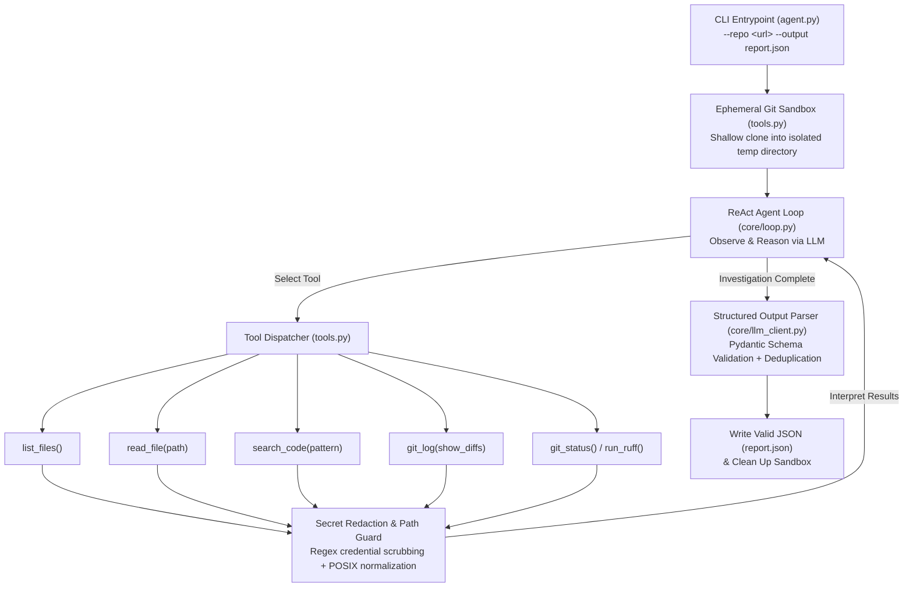

# Autonomous ReAct AI Agent for DevOps Repository Auditing

**Repository:** [https://github.com/dani-234/mlops-assignment2-danish](https://github.com/dani-234/mlops-assignment2-danish)

An autonomous, framework-free AI agent written in Python that inspects public GitHub repositories, dynamically orchestrates static and historical inspection tools, identifies Software Engineering and DevOps best-practice violations, and outputs a strict, schema-validated JSON audit report.

---

## 1. System Architecture & Agent Loop

Built natively in Python without external orchestration frameworks (no LangChain, LangGraph, or n8n), the agent implements an explicit **ReAct (`Observe -> Reason -> Select Tool -> Execute Tool -> Interpret Results -> Report`)** state machine in `core/loop.py`.



### Key Engineering Highlights
- **Dynamic Tool Selection (`core/loop.py`):** Starts with repository discovery (`list_files`, `git_log`), maps the project stack, and autonomously sequences follow-up tool calls (`read_file`, `search_code`, `run_ruff`) to verify context before reporting.
- **Gemini-Compatible Tool Orchestration (`core/llm_client.py`, `core/loop.py`):** When using `GEMINI_API_KEY`, the agent switches from native function-calling to strict JSON action selection (`{"action":"tool"| "final"}`) to preserve multi-step autonomous auditing on Gemini endpoints.
- **Zero-Trust Sandbox & Safety (`tools.py`):** Target repositories are cloned with `GIT_TERMINAL_PROMPT=0` into an ephemeral `tempfile` directory. Path traversal outside the sandbox is blocked, untrusted repository code is never executed, and read-only `.git` packfiles are cleaned up across both Windows and Linux.
- **Defense-in-Depth Secret Scrubbing (`tools.py`):** Multi-pattern regex redaction scrubs API keys (`sk-...`, `ghp_...`, `AKIA...`, `AIza...`), PEM private keys, and password/secret assignments *before* tool output enters the LLM context or `report.json`.
- **Anti-False-Positive Guardrails (`core/prompts.py` & `core/loop.py`):** Recognizes valid architectural equivalents (e.g., `pyproject.toml` vs `requirements.txt`), never infers remote GitHub branch protection rules from local files, and deduplicates findings via post-processing.

---

## 2. Repository Structure

```text
├── agent.py                 # CLI entry point (--repo, --output, exit codes)
├── tools.py                 # Sandboxed inspection tools & secret redaction layer
├── core/
│   ├── __init__.py
│   ├── llm_client.py        # Multi-provider OpenAI SDK wrapper with retry & fallback
│   ├── loop.py              # Explicit ReAct loop, depth guard, and post-processor
│   ├── prompts.py           # Master DevOps auditing system prompt & category rules
│   └── schemas.py           # Pydantic v2 models enforcing the JSON output contract
├── tests/
│   ├── test_tools.py        # Unit tests for sandbox tools, path safety, & secret scrubbing
│   └── test_agent.py        # CLI argument tests, deduplication, & JSON schema compliance
├── .github/workflows/ci.yml # Automated GitHub Actions lint and test gate
├── requirements.txt         # Installable Python dependencies
├── pyproject.toml           # Project metadata, pytest, and ruff configurations
├── .env.example             # Environment variable template (no real credentials)
├── sample_report.json       # Authentic example output generated by the agent
└── README.md                # Setup, architecture, and execution documentation
```

---

## 3. Installation & Setup

### Prerequisites
- **Python 3.10+**
- **Git** installed and available on system `PATH`

### Step 1: Clone the Repository & Create a Virtual Environment
```bash
git clone https://github.com/dani-234/mlops-assignment2-danish.git
cd mlops-assignment2-danish

# Linux / macOS
python3 -m venv .venv
source .venv/bin/activate

# Windows (PowerShell)
python -m venv .venv
.\.venv\Scripts\Activate.ps1
```

### Step 2: Install Dependencies
```bash
pip install -r requirements.txt
```

### Step 3: Configure API Credentials
Copy `.env.example` to `.env` and supply **one** of the supported LLM API keys:
```bash
cp .env.example .env
```
- `OPENAI_API_KEY`: Standard OpenAI API key (`gpt-4o-mini` default, configurable via `LLM_MODEL`).
- `GITHUB_TOKEN`: GitHub Personal Access Token for GitHub Models (`[https://models.inference.ai.azure.com](https://models.inference.ai.azure.com)`, uses `gpt-4o`).
- `GEMINI_API_KEY`: Google Gemini API key via OpenAI-compatible endpoint (`gemini-3.8-flash` default; the client normalizes to `models/...` automatically).

---

## 4. Execution Instructions

Run the agent unattended via the CLI:
```bash
python agent.py --repo https://github.com/octocat/Hello-World --output report.json
```

*(Both `--repo` and `-repo` flags are supported for compatibility.)*

- **Exit Code `0`:** Writes validated JSON to `report.json` (including `"violations": []` if no issues are found).
- **Exit Code `1`:** Prints a descriptive error message to `stderr` on invalid URLs, clone failures, or missing credentials.

---

## 5. Running Automated Tests & Linter

```bash
ruff check .
pytest -v
```
